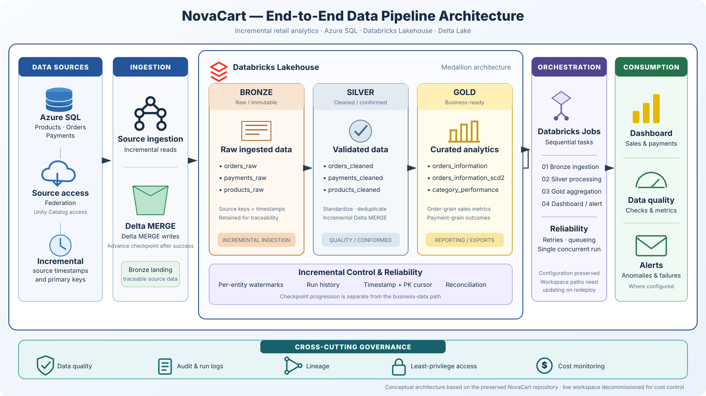
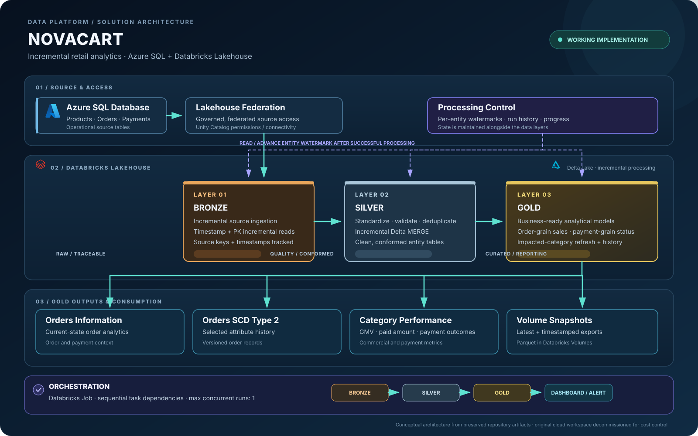

# NovaCart | Incremental Retail Data Engineering Platform

An incremental retail lakehouse that combines Azure SQL Database, Databricks Lakehouse Federation and Delta Lake to build governed Bronze, Silver and Gold data products for order, payment and category analytics.

**Stack:** Azure SQL Database, Azure Databricks, Lakehouse Federation, Apache Spark / PySpark, Delta Lake, Databricks Jobs, Unity Catalog, SQL, GitHub Actions.

> **Project status: COMPLETED — SUCCESSFULLY EXECUTED END TO END (5 November 2026).** NovaCart is a completed end-to-end data engineering project. The latest implementation was successfully run in its intended Azure Databricks environment. The original cloud workspace was later decommissioned to control costs; the notebooks, SQL, dashboard export, orchestration configuration, tests and engineering documentation remain preserved here. NovaCart is a portfolio implementation, not a continuously hosted public service.

## Platform at a glance

| Area | Implementation |
|---|---|
| Business domain | Retail orders, products and payments |
| Source | Azure SQL Database |
| Source access | Databricks Lakehouse Federation |
| Processing | Azure Databricks and PySpark |
| Storage and table format | Delta Lake |
| Incremental state | Timestamp and primary-key watermarks |
| Historical model | SCD Type 2 order history |
| Orchestration | Databricks Jobs |
| Analytics | Gold datasets and Databricks SQL dashboard |

## Business problem

Retail operations produce related product, order, and payment data. NovaCart demonstrates a layered approach for preparing that operational data for consistent reporting, tracking selected changes over time, and presenting business-oriented metrics.

The platform is designed to support:
- A consolidated view of orders and payments.
- Category-level gross merchandise value (GMV) and payment performance.
- Incremental processing rather than repeatedly rebuilding every downstream dataset.
- Current-state and historical order analysis.
- A scheduled workflow for processing and analytics tasks.

## Architecture

### End-to-end platform overview



This presentation diagram gives the high-level view: operational sources, ingestion, the Databricks Lakehouse medallion layers, orchestration, analytics, alerts, and cross-cutting governance. The diagram is a solution overview; individual connectors and services should be read alongside the implementation details below.

### Detailed processing flow



The detailed diagram focuses on incremental control state, Bronze/Silver/Gold responsibilities, Gold outputs and the saved Databricks job flow. The original workspace was decommissioned for cost control after the project was successfully executed in its Azure Databricks environment.

## Technology stack

| Area | Technology | Role |
|---|---|---|
| Source | Azure SQL Database | Products, orders, payments |
| Data access | Databricks Lakehouse Federation | Access to source tables |
| Processing | Azure Databricks, Apache Spark | Distributed transformations |
| Table format | Delta Lake | Layered tables and merge operations |
| Data modeling | PySpark, Spark SQL | Cleansing and business transformations |
| Incremental state | Timestamp and primary-key watermarks | Track processing progress |
| Historical modeling | SCD Type 2 pattern | Preserve selected order history |
| Orchestration | Databricks Jobs | Coordinate notebook and downstream tasks |
| Analytics | Databricks SQL dashboard | Stakeholder reporting |
| Version control | Git, GitHub | Source and configuration artifacts |

## Data workflow

### 1. Source access and Bronze

The source model contains three entities:

- `products`: product attributes, categories, prices, and `updated_at`.
- `orders`: order, customer, product, status, amount, and timestamp fields.
- `payments`: payment status, amount, order association, and `processed_at`.

The Bronze workflow uses source-specific timestamp and primary-key tracking, with an ingestion control table recording progress and row-write metadata.

### 2. Silver transformations

The Silver workflow prepares data for business use through cleaning, locale-aware amount parsing, standardization, deduplication, data-quality handling, and incremental Delta `MERGE` operations. Valid transformed tables preserve the last-known-good state when a newer source version is invalid; the invalid version remains visible in cleaned/quarantine tables. Processing metadata is maintained to support incremental downstream work.

### 3. Gold analytics

The Gold workflow identifies changed entities and updates curated datasets. Its documented outputs include:

| Dataset | Purpose |
|---|---|
| `orders_information` | Current-state order and payment analysis |
| `orders_information_scd2` | Historical versions of selected order attributes |
| `category_performance` | Category-level commercial and payment metrics |
| Databricks Volume snapshots | Latest and timestamped Parquet exports |

The category-performance model includes total orders, GMV, paid amount, average payment completion, and payment failure rate. Paid amounts use validated successful payment rows; payment-health metrics use the cleaned attempt feed so a failed attempt with a quarantined amount still contributes to failure rate. See the data dictionary for exact definitions.

## Orchestration

The saved job configuration, `novacart_job.json`, defines the following dependency chain:

1. `bronze_work` — incremental source ingestion.
2. `silver_work` — cleansing, quality handling, and Delta merges.
3. `gold_work` — business transformations and aggregates.
4. `novacart_dashboard` — dashboard task.
5. `n_alert` — SQL alert task.

Downstream tasks use `ALL_SUCCESS` dependencies. The job configuration enables queuing and sets `max_concurrent_runs` to `1`.

The JSON preserves configuration intent, but contains environment-specific workspace paths and resource IDs. These must be updated when redeploying. The presence of an exported dashboard or job definition does not mean those live resources still exist.

## Design decisions and trade-offs

**Incremental processing:** Watermarks reduce unnecessary reads, but correctness depends on timestamp quality, ties, late-arriving updates, and when checkpoints are advanced.

**Delta MERGE:** Merge-based updates support current-state tables when source records change. Correctness depends on stable keys, deterministic transformations, and suitable match conditions.

**SCD Type 2:** Historical versions provide change context beyond the current-state view, with additional storage and transformation complexity.

**Impacted-category processing:** Updating only affected categories can reduce repeated work, provided all changes that affect those categories are identified. Reconciliation against a full recomputation is a key validation method.

**Lakehouse Federation:** Direct source access avoids a conventional extraction connector for that access path, but still depends on source availability, permissions, networking, and query performance.

## Engineering documentation

| Document | Purpose |
|---|---|
| [End-to-end architecture visual](docs/novacart-end-to-end-architecture.svg) | Portfolio-level platform overview, sources, processing, orchestration, analytics, and governance |
| [Detailed architecture diagram](docs/novacart-architecture.svg) | Incremental control state, medallion layers, Gold outputs, and job flow |
| [Deployment guide](docs/DEPLOYMENT.md) | Steps and prerequisites to recreate the environment |
| [Data dictionary](docs/DATA_DICTIONARY.md) | Tables, fields, metrics, and data-quality considerations |
| [Engineering decisions](docs/ENGINEERING_DECISIONS.md) | Rationale, trade-offs, and correctness conditions |
| [Operations runbook](docs/OPERATIONS_RUNBOOK.md) | Failure investigation, recovery, and reconciliation |
| [Validation plan](docs/VALIDATION_PLAN.md) | Acceptance criteria and test scenarios to execute |
| [Artifact audit](docs/ARTIFACT_AUDIT.md) | Review of preserved artifacts, engineering improvements, CI checks, and execution scope |
| [Senior engineering readiness review](docs/SENIOR_ENGINEERING_READINESS.md) | Portfolio assessment, strengths, limitations, and next validation priorities |
| [Execution record](docs/EXECUTION_RECORD.md) | End-to-end environment execution and validation scope |
| [Release package guide](docs/RELEASE_PACKAGE.md) | How to retrieve the clean, CI-generated project archive |

The project is a completed working implementation, successfully executed end to end in Azure Databricks. The validation plan remains the repeatable checklist for detailed acceptance and regression scenarios; a successful overall run does not, by itself, prove every edge-case scenario in that plan.

## Automated validation and release package

The repository includes a GitHub Actions workflow that validates notebook JSON and Python cell syntax, job/dashboard JSON, both architecture SVGs, README documentation links, and the shared-module imports. It then runs local-Spark transformation tests for Bronze, Silver, and Gold, checks job/dashboard contracts, and builds and inspects a clean `NovaCart-Release.zip` artifact. Open the [NovaCart release workflow history](https://github.com/viradidi/1NOVACART-CASE-STUDY/actions/workflows/package-novacart-release.yml) and download the `NovaCart-Release` artifact from the latest successful run; GitHub retains workflow artifacts for 30 days. The workflow runs local Spark tests and checks the release package, but it is not a live Databricks pipeline execution. See the [release package guide](docs/RELEASE_PACKAGE.md).


**Execution status:** the project was successfully executed end to end in Azure Databricks on 5 November 2026. The dashboard JSON is the versioned dashboard configuration. CI separately runs local Spark tests against shared Bronze, Silver and Gold transformations and checks dashboard/job contracts; it does not execute the full Databricks pipeline. See the [artifact audit](docs/ARTIFACT_AUDIT.md) for details about the preserved release contents.

## Run tests locally

The repository-side test suite runs with Python 3.11, Java 17, and the pinned PySpark dependency:

```bash
python -m pip install -r requirements-dev.txt
python -m unittest discover -s tests -v
```

The suite exercises Bronze watermark and timestamp rules; Silver money parsing, deduplication and deterministic quarantine identities; Gold payment rollups, category metrics and retry recovery from SCD2 history; plus job-template and dashboard contracts. It does not connect to Azure SQL, Databricks Unity Catalog, Lakehouse Federation, Databricks Jobs, dashboard rendering, or SQL alert delivery.

## Repository contents

- `bronze_work.ipynb`, `silver_work.ipynb`, `gold_work.ipynb` — layered processing notebooks.
- `novacart_transformations.py` — shared Spark transformation functions imported by the notebooks and exercised by local-Spark unit tests.
- SQL scripts — source table definitions and load examples.
- `NovaCart Sales & Payments Overview.lvdash.json` — exported dashboard artifact.
- `novacart_job.json` — sanitized Databricks Job redeployment template. Render a target-workspace definition with `python deployment/render_novacart_job.py --workspace-root /Workspace/Shared/NovaCart --dashboard-id <id> --alert-id <id> --warehouse-id <id> --output novacart_job.rendered.json`.
- `docs/` — architecture and engineering documentation.
- `1NOVACART-CASE-STUDY.zip` — legacy Databricks/Git export; see [the artifact audit](docs/ARTIFACT_AUDIT.md). It contains `.git/` metadata and does not include the current dashboard export or current documentation, so do not use it as the current project bundle.

## Redeployment guide

The original Azure Databricks workspace was decommissioned to control costs after the project was successfully executed in its intended environment on 5 November 2026. NovaCart is not represented as a continuously hosted service; use these steps to provision a fresh or repeatable environment:

1. Provision the Azure SQL source and load the required tables and data.
2. Create an Azure Databricks workspace and configure access to Azure SQL.
3. Configure Unity Catalog and Lakehouse Federation with the required permissions and networking.
4. Recreate the catalog, schemas, control tables, Delta tables, and Volume.
5. Import the notebooks and update environment-specific paths and settings.
6. Run Bronze, Silver, and Gold in dependency order.
7. Recreate or import the dashboard and SQL alert using the supported Databricks interfaces.
8. Recreate the job from `novacart_job.json`, replacing resource IDs and paths.
9. Validate an initial load, subsequent incremental runs, data quality, and business metrics before enabling any schedule.

See the [deployment guide](docs/DEPLOYMENT.md) for the detailed checklist.

## Security and cost controls

- Never commit credentials, access tokens, or private connection strings.
- Use approved secret management and least-privilege access.
- Replace personal workspace paths, account-specific IDs, and subscriptions when deploying elsewhere.
- Set compute limits, auto-termination, and schedules deliberately.
- Review Azure Cost Management and remove unused resources only after preserving required data and configuration.

## Known limitations and next validation milestones

- **End-to-end execution:** the project ran successfully in Azure Databricks on 5 November 2026. The repository preserves the implementation and repeatable setup guidance; it does not claim a continuously hosted workspace.
- **Incremental-source assumptions:** the timestamp-plus-primary-key cursor depends on reliable source change timestamps and ordered cursor semantics. Late or backdated changes and hard deletes need a deliberate lookback, CDC, or reconciliation strategy; a timestamp watermark alone does not detect every source mutation.
- **Integration scope:** CI runs local Spark tests against shared transformation functions and validates notebook/configuration contracts. It does not execute the complete notebooks in Databricks or verify Azure SQL federation, Unity Catalog permissions, live Delta transactions, dashboard rendering, or alert delivery.
- **Operations and performance:** the repository documents recovery procedures, but does not retain measured throughput, cost baselines, latency objectives, alert-response evidence, or production SLOs.
- **Data realism:** the case study uses synthetic retail data and is an engineering demonstration, not a live retail production service.

The detailed scenario matrix is in the [validation plan](docs/VALIDATION_PLAN.md). These are additional operational-readiness improvements and do not change the successful completed end-to-end execution.

## Project deliverables

This repository preserves the main notebooks, SQL scripts, dashboard export, job template, architecture visuals, automated tests and engineering documentation for the NovaCart case study. The [artifact audit](docs/ARTIFACT_AUDIT.md) documents the release contents and engineering improvements; the [execution record](docs/EXECUTION_RECORD.md) describes the successful Azure Databricks run and validation scope. The legacy ZIP is not the preferred distribution package; use the current repository contents.

**Repository:** [viradidi/1NOVACART-CASE-STUDY](https://github.com/viradidi/1NOVACART-CASE-STUDY)

**Author:** Isaiah Nyakundi


## Interview walkthrough

A useful technical walkthrough of NovaCart is:

1. Explain why the platform uses Bronze, Silver, and Gold rather than transforming operational tables directly into reporting tables.
2. Walk through the timestamp-plus-primary-key watermark strategy and explain the assumptions it makes about source change timestamps, ties, late-arriving changes, and checkpoint advancement.
3. Explain how Delta MERGE is used in the processing layers, including the keys and change-detection rules that determine whether a row is inserted or updated.
4. Describe how Silver quality handling and deduplication protect downstream business models.
5. Explain the grain of each Gold output, especially why order-level reporting and payment-level failure metrics must not be mixed without aggregation.
6. Walk through the SCD Type 2 order-history model and the tests needed to preserve one current version per business key.
7. Explain how impacted-category processing handles a product moving between categories, and how a full recomputation can be used for reconciliation.

The strongest interview discussion is not just the technology list; it is the correctness conditions, trade-offs, failure cases, and validation strategy behind each design.
