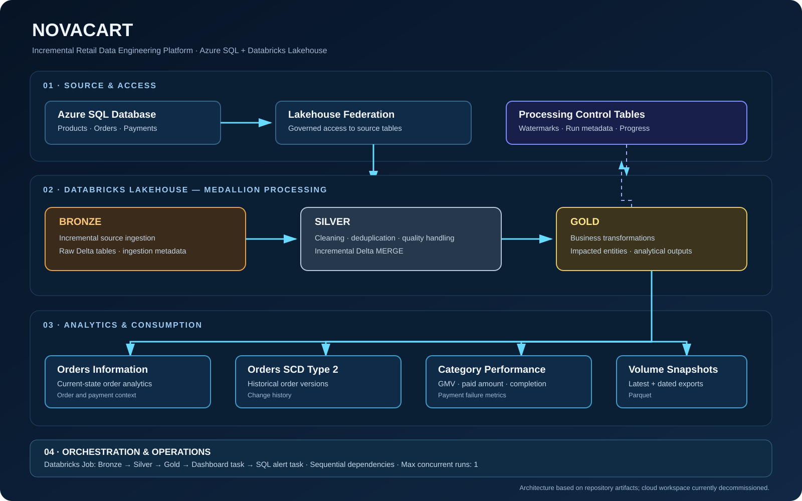

# NovaCart | Incremental Retail Data Engineering Platform

An end-to-end data engineering case study using Azure SQL Database, Azure Databricks, Lakehouse Federation, Delta Lake, incremental processing, and stakeholder analytics.

> **Project status: WORKING IMPLEMENTATION.** NovaCart is an implemented end-to-end data engineering project that has been run in its original environment. The cloud workspace was later decommissioned to control costs; the project code, notebooks, SQL, dashboard export, orchestration configuration, and engineering documentation are preserved here. The platform is not currently hosted, and a new live deployment requires recreating the cloud resources.

## Business problem

Retail operations produce related product, order, and payment data. NovaCart demonstrates a layered approach for preparing that operational data for consistent reporting, tracking selected changes over time, and presenting business-oriented metrics.

The platform is designed to support:
- A consolidated view of orders and payments.
- Category-level gross merchandise value (GMV) and payment performance.
- Incremental processing rather than repeatedly rebuilding every downstream dataset.
- Current-state and historical order analysis.
- A scheduled workflow for processing and analytics tasks.

## Architecture

The diagram represents the implemented solution architecture and saved orchestration configuration. The project is working code, while its original cloud environment is currently decommissioned for cost control.

## Technology stack

| Area | Technology | Role |
|---|---|---|
| Source | Azure SQL Database | Products, orders, payments |
| Data access | Databricks Lakehouse Federation | Access to source tables |
| Processing | Azure Databricks, Apache Spark | Distributed transformations |
| Table format | Delta Lake | Layered tables and merge operations |
| Data modeling | PySpark, Spark SQL | Cleansing and business transformations |
| Incremental state | Timestamp and primary-key watermarks | Track processing progress |
| Historical modeling | SCD Type 2 pattern | Preserve selected order history |
| Orchestration | Databricks Jobs | Coordinate notebook and downstream tasks |
| Analytics | Databricks SQL dashboard | Stakeholder reporting |
| Version control | Git, GitHub | Source and configuration artifacts |

## Data workflow

### 1. Source access and Bronze

The source model contains three entities:

- `products`: product attributes, categories, prices, and `updated_at`.
- `orders`: order, customer, product, status, amount, and timestamp fields.
- `payments`: payment status, amount, order association, and `processed_at`.

The Bronze workflow uses source-specific timestamp and primary-key tracking, with an ingestion control table recording progress and row-write metadata.

### 2. Silver transformations

The Silver workflow prepares data for business use through cleaning, standardization, deduplication, data-quality handling, and incremental Delta `MERGE` operations. Processing metadata is maintained to support incremental downstream work.

### 3. Gold analytics

The Gold workflow identifies changed entities and updates curated datasets. Its documented outputs include:

| Dataset | Purpose |
|---|---|
| `orders_information` | Current-state order and payment analysis |
| `orders_information_scd2` | Historical versions of selected order attributes |
| `category_performance` | Category-level commercial and payment metrics |
| Databricks Volume snapshots | Latest and timestamped Parquet exports |

The category-performance model includes total orders, GMV, paid amount, average payment completion, and payment failure rate. Metric definitions and edge-case handling should be aligned with the SQL and notebook implementation.

## Orchestration

The saved job configuration, `novacart_job.json`, defines the following dependency chain:

1. `bronze_work` — incremental source ingestion.
2. `silver_work` — cleansing, quality handling, and Delta merges.
3. `gold_work` — business transformations and aggregates.
4. `novacart_dashboard` — dashboard task.
5. `n_alert` — SQL alert task.

Downstream tasks use `ALL_SUCCESS` dependencies. The job configuration enables queuing and sets `max_concurrent_runs` to `1`.

The JSON preserves configuration intent, but contains environment-specific workspace paths and resource IDs. These must be updated when redeploying. The presence of an exported dashboard or job definition does not mean those live resources still exist.

## Engineering patterns and trade-offs

**Incremental processing:** Watermarks reduce unnecessary reads, but correctness depends on timestamp quality, ties, late-arriving updates, and when checkpoints are advanced.

**Delta MERGE:** Merge-based updates support current-state tables when source records change. Correctness depends on stable keys, deterministic transformations, and suitable match conditions.

**SCD Type 2:** Historical versions provide change context beyond the current-state view, with additional storage and transformation complexity.

**Impacted-category processing:** Updating only affected categories can reduce repeated work, provided all changes that affect those categories are identified. Reconciliation against a full recomputation is a key validation method.

**Lakehouse Federation:** Direct source access avoids a conventional extraction connector for that access path, but still depends on source availability, permissions, networking, and query performance.

## Documentation and engineering evidence

| Document | Purpose |
|---|---|
| [Architecture diagram](docs/novacart-architecture.svg) | High-level solution components and data flow |
| [Deployment guide](docs/DEPLOYMENT.md) | Steps and prerequisites to recreate the environment |
| [Data dictionary](docs/DATA_DICTIONARY.md) | Tables, fields, metrics, and data-quality considerations |
| [Engineering decisions](docs/ENGINEERING_DECISIONS.md) | Rationale, trade-offs, and correctness conditions |
| [Operations runbook](docs/OPERATIONS_RUNBOOK.md) | Failure investigation, recovery, and reconciliation |
| [Validation plan](docs/VALIDATION_PLAN.md) | Acceptance criteria and test scenarios to execute |
| [Artifact audit](docs/ARTIFACT_AUDIT.md) | Static review of dashboard export, ZIP contents, and available execution evidence |

The project is presented as a working implementation. The validation plan is the repeatable acceptance checklist for future deployments and targeted regression scenarios; it is separate from the project's implementation status.

## Repository contents

- `bronze_work.ipynb`, `silver_work.ipynb`, `gold_work.ipynb` — layered processing notebooks.
- SQL scripts — source table definitions and load examples.
- `NovaCart Sales & Payments Overview.lvdash.json` — exported dashboard artifact.
- `novacart_job.json` — saved Databricks Job configuration.
- `docs/` — architecture and engineering documentation.
- `1NOVACART-CASE-STUDY.zip` — legacy Databricks/Git export; see [the artifact audit](docs/ARTIFACT_AUDIT.md). It contains `.git/` metadata and does not include the current dashboard export or current documentation, so do not use it as the current project bundle.

## Redeployment guide

The platform is not currently running because the Azure Databricks workspace was deleted to control costs. To recreate the environment:

1. Provision the Azure SQL source and load the required tables and data.
2. Create an Azure Databricks workspace and configure access to Azure SQL.
3. Configure Unity Catalog and Lakehouse Federation with the required permissions and networking.
4. Recreate the catalog, schemas, control tables, Delta tables, and Volume.
5. Import the notebooks and update environment-specific paths and settings.
6. Run Bronze, Silver, and Gold in dependency order.
7. Recreate or import the dashboard and SQL alert using the supported Databricks interfaces.
8. Recreate the job from `novacart_job.json`, replacing resource IDs and paths.
9. Validate an initial load, subsequent incremental runs, data quality, and business metrics before enabling any schedule.

See the [deployment guide](docs/DEPLOYMENT.md) for the detailed checklist.

## Security and cost controls

- Never commit credentials, access tokens, or private connection strings.
- Use approved secret management and least-privilege access.
- Replace personal workspace paths, account-specific IDs, and subscriptions when deploying elsewhere.
- Set compute limits, auto-termination, and schedules deliberately.
- Review Azure Cost Management and remove unused resources only after preserving required data and configuration.

## Future improvements

Engineering capabilities include layered incremental processing, Delta MERGE patterns, per-entity Gold processing state, replay-safe Bronze writes, order-grain Gold output, payment-grain failure metrics, category-move refresh logic, SCD Type 2 history, snapshots, and documented orchestration. Additional environment-specific regression evidence can be captured when the cloud workspace is recreated; this does not change the project's working implementation status.

## Project deliverables

This repository preserves the main notebooks, SQL scripts, dashboard export, job template, architecture visual, and supporting engineering documentation for the NovaCart case study. The [artifact audit](docs/ARTIFACT_AUDIT.md) documents the release contents and the engineering improvements committed to the working implementation. The legacy ZIP is not the preferred distribution package; use the current repository contents.

**Repository:** [viradidi/1NOVACART-CASE-STUDY](https://github.com/viradidi/1NOVACART-CASE-STUDY)

**Author:** Isaiah Nyakundi
